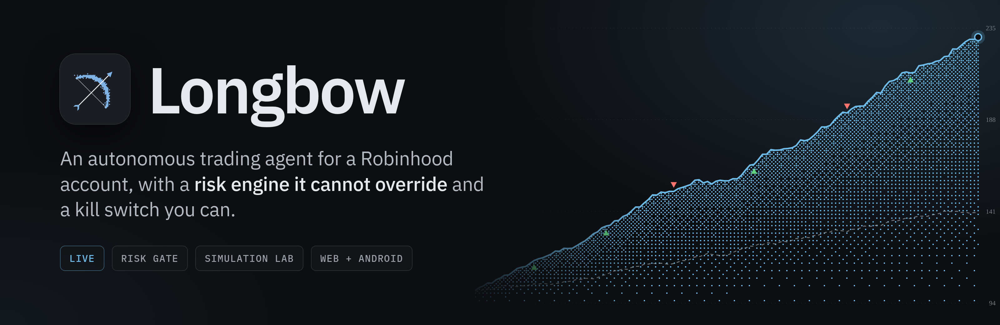
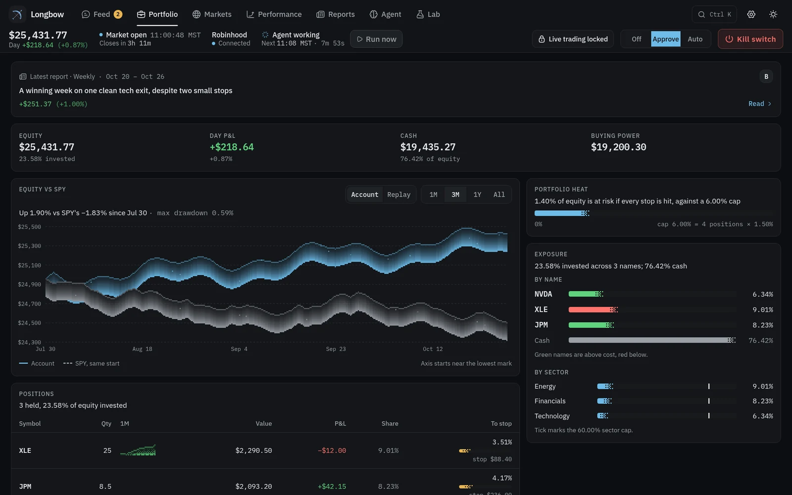
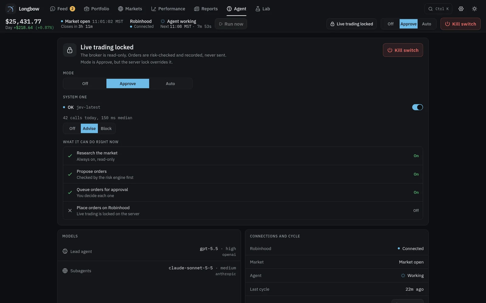
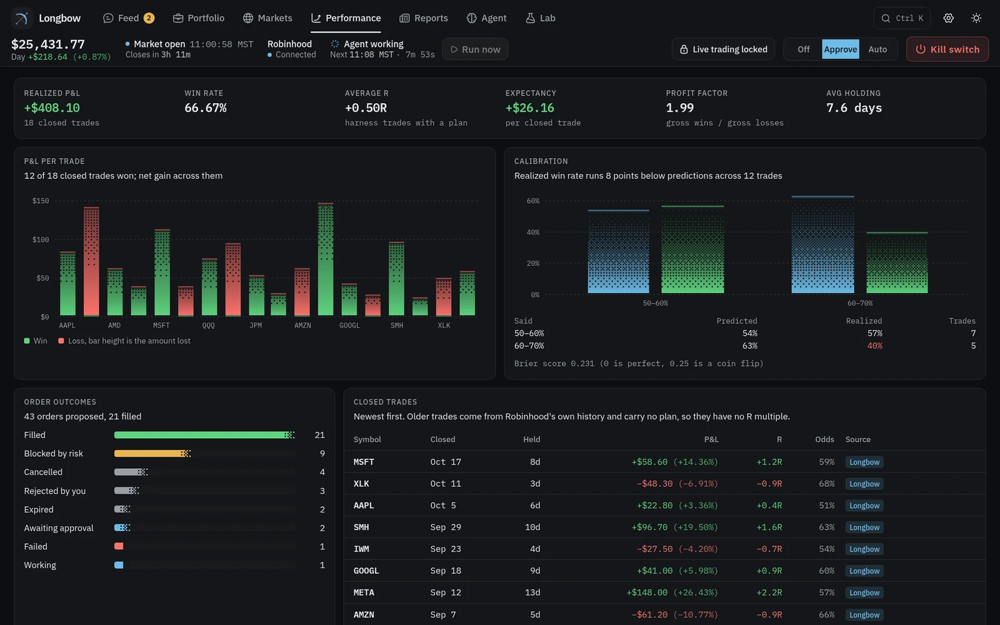
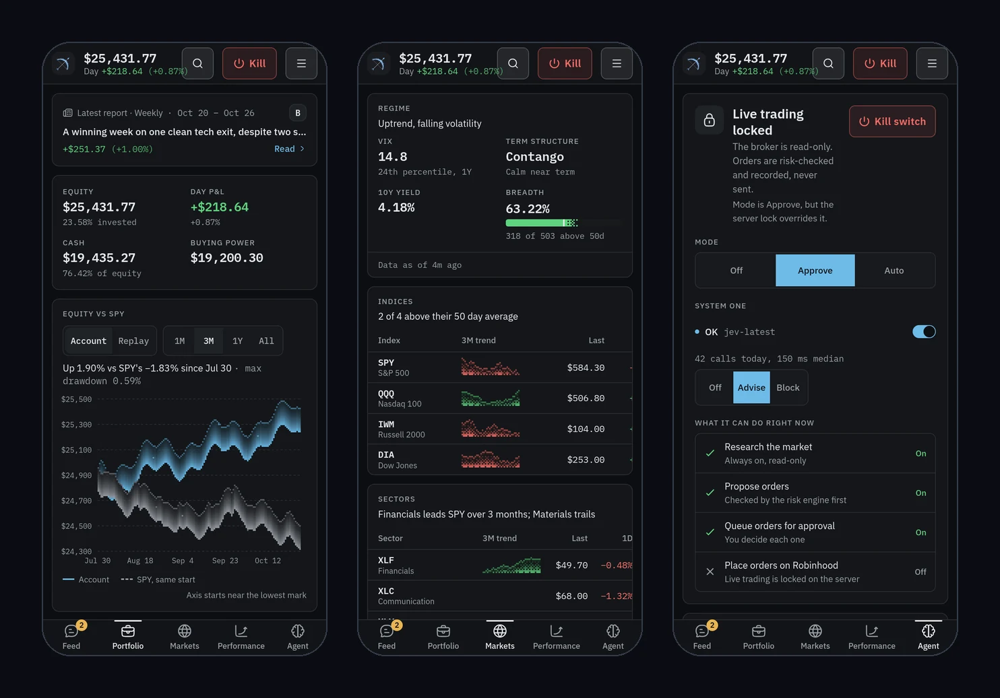
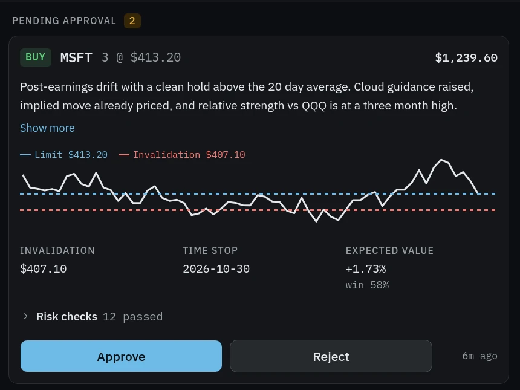
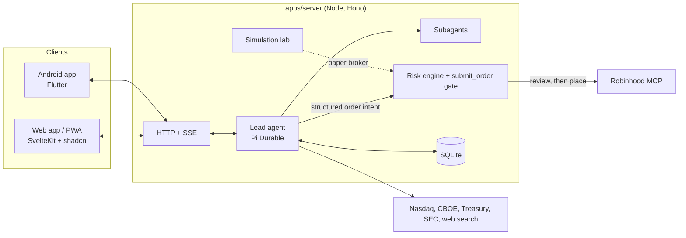
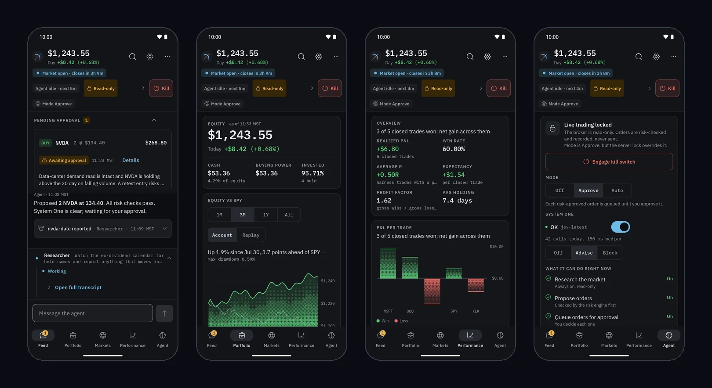

<p align="center">
  
</p>

# Longbow

Longbow is a harness that lets an AI agent research, plan, and place trades in a Robinhood account, around the clock, without being able to talk its way past the rules you set. The model proposes. A deterministic risk engine decides. You watch it all from a phone-first web app or the Android app, and you can stop everything with one tap.

It was built for a small cash account trading fractional shares of liquid ETFs and mega caps, and the defaults reflect that.

> **Warning.** This software can place real orders with real money. Nothing here is financial advice, and an autonomous agent can lose money quickly. Live trading is off until you turn it on, start in `approve` mode, read the risk limits, and use it at your own risk. No warranty of any kind.

<p align="center">
  
  <br />
  <sub>Screenshots in this README use fictional demo data, not a real account.</sub>
</p>

## What it does

- **An agent that works the whole day.** One durable lead agent runs scheduled cycles (pre-open, every 30 minutes while the market is open, post-close, and every 4 hours overnight) and answers your chat messages mid-cycle. It reads the news and filings, pulls market data, and keeps a journal, a notes workspace, and a set of playbooks ("skills") it loads on demand.
- **A risk gate the model cannot bypass.** The model never sees Robinhood's order tools. It calls `submit_order` with a structured plan (thesis, invalidation price, time stop, expected value, evidence). The gate runs the risk engine, then Robinhood's own review, then places the order or queues it for your approval.
- **Three trading modes.** `off` is research only, `approve` waits for your tap, `auto` places risk-approved orders. A kill switch stops all order placement immediately, and a hard server-side lock keeps the broker read-only until you set `HARNESS_LIVE_TRADING=1`.
- **Subagents.** The lead delegates legwork to read-only analyst, bull, bear, risk-reviewer, and researcher subagents, and can run long-lived named helpers in the background.
- **A simulation lab.** Replay past trading days at accelerated speed against a paper broker with realistic spreads, slippage, fees, and gap-through stops. Run blind (aliased tickers, fictional calendar) or bootstrap markets so the model's memory of real events cannot help, then compare strategy variants on identical markets with a confidence interval.
- **Reports with honest numbers.** Daily, weekly, and per-trade briefs. The agent writes the narrative and a grade for decision quality, but every figure is computed by the server, never by the model.
- **A quant toolkit.** Screening, backtesting, portfolio risk, and position sizing tools the agent can call.
- **A fast second opinion.** System One (TypeSafe's Jev decision model) screens news for planted instructions, triages candidates, and checks a thesis against its evidence. It advises, or in `block` mode can tighten the gate on a high-confidence concern. It never sizes, places, or cancels orders. See [`docs/SYSTEM-ONE.md`](docs/SYSTEM-ONE.md).
- **Push notifications** for fills, failures, halts, sign-in problems, the daily review, and finished simulations.

<p align="center">
  
</p>

The Agent screen is the control room: the mode, the kill switch, System One, and a plain list of what the agent is allowed to do right now.

<p align="center">
  
</p>

Performance tracks how the agent actually trades, including whether its stated win probabilities hold up (the calibration chart and Brier score).

<p align="center">
  
</p>

### The risk engine

In `approve` mode, every entry that clears the engine waits for your tap, with the thesis, the invalidation price, the time stop, and the risk checks in front of you:

<p align="center">
  
</p>

Every entry is checked against limits you can edit in the app. Defaults:

| Rule | Default |
| --- | --- |
| Max loss to invalidation, per trade | 1.5% of equity |
| Max single position / sector | 30% / 60% of equity |
| Max open positions, entries per day | 4, 2 |
| Order size cap (fat-finger guard) | $500 |
| Daily loss halt, monthly drawdown halt | 3%, 8% (the monthly halt needs a human re-arm) |
| Max spread, max slippage through mid | 20 bps, 10 bps |
| No new entries after the open / before the close | 30 min, 15 min |
| Day trades in 5 business days | 3 |
| Expected value after costs vs round-trip costs | at least 2x |
| Earnings blackout, liquidity floor | 5 days, $20M average daily volume |

Fees are part of the math: regulatory SEC, FINRA TAF, and CAT fees are modeled, and an entry whose edge does not survive spread, slippage, and fees is rejected.

## Architecture



- `apps/server`: Node 26 and Hono. The agent runs on `@earendil-works/pi-durable` with SQLite storage and a Code Mode tool: the model writes JavaScript that calls every other tool (`rh_*` read tools, `market_*`, `sec_company`, web search, skills, notes, risk, journal, `delegate`) in parallel.
- `apps/web`: a SvelteKit static single-page app with shadcn-svelte, Tailwind 4, and dithered charts. Installable as a PWA.
- `apps/mobile`: the native Android app in Flutter (see below): models, a Riverpod data layer with tailnet auto-connect, a design system with dithered charts, and one folder per feature.
- `packages/shared`: the wire contract (types and zod schemas) used by every client.
- Market data comes from free sources: Nasdaq daily bars and earnings, CBOE VIX, US Treasury yields, and SEC EDGAR. Indicators are computed server-side.

Access control is the network: the server only accepts loopback and [Tailscale](https://tailscale.com) addresses, and mutating requests need an `x-harness` header. There is no app login, so do not expose the port to the internet.

## Run it

You need [Bun](https://bun.sh), Node 26 or newer, a Robinhood account with the Robinhood trading MCP available, and model access (see below).

```sh
bun install
bun run start        # builds the web app, then serves everything on http://127.0.0.1:4520
```

Open the app and choose **Connect Robinhood**. Leave the mode on **Approve** until you trust the agent. For development, `bun run dev:server` and `bun run dev:web` run the two halves separately.

To run it as a service, copy `ops/robinhood-harness.service` to `~/.config/systemd/user/`. Machine-specific settings go in `~/.config/robinhood-harness/env`, outside the repo. More in [`docs/RUNBOOK.md`](docs/RUNBOOK.md).

### Models

The lead agent defaults to `openai-codex/gpt-6.1-sol` at `xhigh` reasoning through its own ChatGPT sign-in (`node apps/server/scripts/codex-login.ts`), and subagents default to `meta/muse-spark-1.3-contributor` through a Muse CLI login. Both are overridable with `MAIN_MODEL` and `SUBAGENT_MODEL` in `provider/model#thinking` form. Without a ChatGPT login the lead falls back to the subagent model. On `gpt-6.1-sol`, long conversations compact natively through Codex's own compaction item; every other model, including Muse, uses regular text summaries.

### Configuration

| Variable | Purpose |
| --- | --- |
| `PORT`, `HARNESS_BIND` | Port (default 4520) and `0.0.0.0` to listen beyond loopback |
| `HARNESS_TAILNET_HOST`, `HARNESS_ORIGINS` | Your Tailscale IP and allowed web origins |
| `HARNESS_LIVE_TRADING` | `1` lets orders reach Robinhood. Anything else keeps the broker read-only |
| `DATA_DIR` | State directory (default `~/.local/share/robinhood-harness`) |
| `MAIN_MODEL`, `SUBAGENT_MODEL` | Model specs |
| `WEBSEARCH_CONFIG_FILE` | MCP config holding the web search endpoint |
| `SEC_CONTACT` | `Your Name you@example.com`, required by SEC EDGAR's fair-access policy |
| `SIM_CONCURRENCY` | Parallel simulations, 1 to 4 (default 2) |

## Android app

<p align="center">
  
</p>

`apps/mobile` is a fully native Flutter app (no WebView) with every screen of the web app: the live feed with tool traces and approvals, portfolio, symbol charts, markets, performance, agent control room, reports with share and PDF print, journal and orders, notes and skills, the simulation lab, and settings. It finds your server on your tailnet by itself, streams updates live, and keeps a foreground service open for trade alerts.

```sh
cd apps/mobile
cp hosts.example.json hosts.local.json     # set LONGBOW_HOSTS to your tailnet host(s); the file is gitignored
flutter build apk --release --target-platform android-arm64 --dart-define-from-file=hosts.local.json
scripts/publish.sh                          # same build, then copies it to where the server hosts /download/longbow.apk
```

Install Tailscale on the phone and sign in to the same tailnet; the app tries `https://<host>:8443` and `http://<host>:4520` for each host and remembers the one that answers. You can also type a host on the connect screen. Design tokens and behaviors are in [`apps/mobile/DESIGN.md`](apps/mobile/DESIGN.md).

## Develop

```sh
bun run typecheck    # shared, server, and web
bun run test         # shared and server tests (node:test)
cd apps/web && bun run test      # web tests (vitest)
cd apps/mobile && flutter analyze && flutter test
```

Scope, the roadmap, and open follow-ups are in [`docs/SPEC.md`](docs/SPEC.md) and [`docs/ROADMAP.md`](docs/ROADMAP.md). [`AGENTS.md`](AGENTS.md) holds the hard rules for anyone, human or AI, changing this code: orders only through `submit_order`, report figures only from the server, and no secrets in logs.

## License

[MIT](LICENSE). The license covers the code, not the risk: see the warning at the top.
